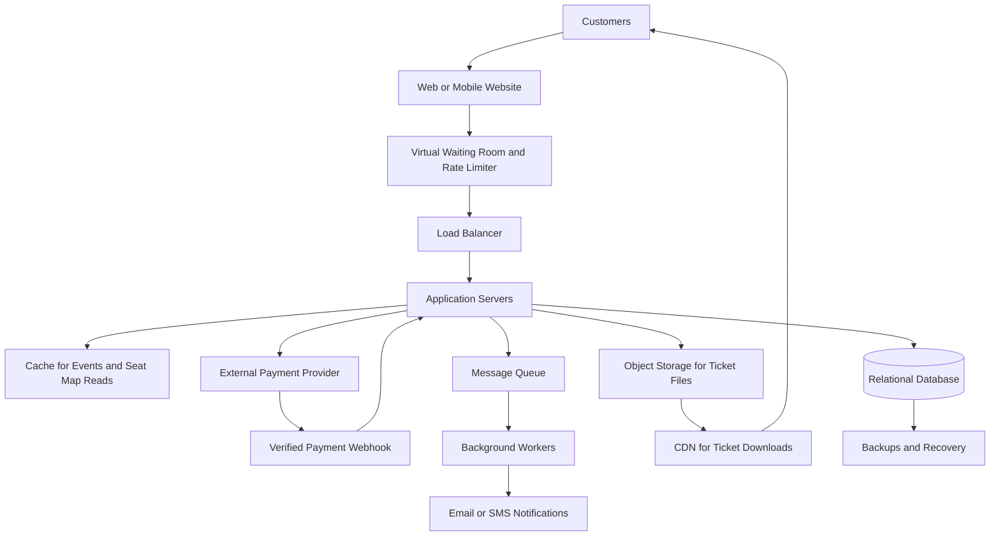

# TicketHub: Ticketing System Design

## 1. Requirements

### Functional requirements
- Users can register, sign in, and manage their accounts.
- Users can browse and search concerts and events.
- Users can view event details, prices, and seat availability.
- Users can temporarily hold available seats while checking out.
- Users can pay securely and receive a booking confirmation.
- Users can view their orders and tickets.
- The system releases expired or unpaid seat holds automatically.
- Administrators can create events, define seating plans, and monitor sales.

### Non-functional requirements
- **Speed:** Event listings and seat maps should normally load within two seconds.
- **Correctness:** A seat must never be sold to two customers. Payments and ticket records must remain consistent.
- **Fairness:** Customers should be processed in a transparent order, using a virtual waiting room or queue during very popular sales. The system should not favour customers simply because they refresh repeatedly.
- **Availability:** Browsing should continue where possible even if the payment service is temporarily unavailable.
- **Scalability:** The system must handle sudden increases in traffic without overwhelming the database.
- **Security:** Use HTTPS, secure authentication, access controls, and a trusted payment provider. Never store raw card details.
- **Reliability:** Use retries, monitoring, backups, and recovery procedures.
- **Usability:** The website should work on mobile devices and provide clear messages when seats are unavailable or a payment fails.

## 2. Traffic estimates

### Normal day
- Registered users: 2,000,000.
- Daily visitors: 50,000.
- Page views: 50,000 × 10 = **500,000 page views per day**.
- Average page requests: 500,000 ÷ 86,400 seconds = approximately **5.8 requests per second**.
- Tickets sold: 5,000 per day, averaging approximately **0.058 tickets per second**.

These are daily averages. Actual traffic will be higher during popular events, so capacity should not be based on averages alone.

### Popular concert sale
- People trying to buy: 200,000.
- Available seats: 20,000.
- Time window: 10 minutes (600 seconds).
- Average incoming purchase attempts: 200,000 ÷ 600 = approximately **333 attempts per second**.
- Maximum possible seat sales: 20,000 ÷ 600 = approximately **33 successful sales per second** if every seat sells evenly throughout the window.
- Demand is **10 people for every seat**.

The sale creates a sudden spike in traffic and contention for seats. The system must queue requests, cache read-heavy event information, protect the database, and enforce seat ownership at the database level. A waiting room can smooth the incoming traffic, but it must not promise a ticket to everyone in the queue.

## 3. API design

All endpoints use HTTPS and return JSON. Protected endpoints require authentication.

| Method and endpoint | Purpose |
|---|---|
| GET /api/events | Browse and search upcoming events. |
| GET /api/events/{eventId} | View event details, venue, date, and prices. |
| GET /api/events/{eventId}/seats | View seats and their current availability. |
| POST /api/holds | Temporarily hold selected seats for a customer. Request includes event ID and seat IDs. |
| GET /api/holds/{holdId} | Check whether a hold is still valid. |
| POST /api/orders | Create an order from a valid hold and initiate checkout. |
| POST /api/payments/webhook | Receive verified payment-provider status updates. |
| GET /api/me/tickets | View the signed-in user's purchased tickets. |

The hold and order endpoints must validate the customer, event, seat IDs, and hold expiry. Requests that create holds or orders should support idempotency keys so a network retry does not create duplicate operations. Payment webhooks must be authenticated and processed idempotently.

## 4. Data model

### users
- `id` — primary key.
- `name` — customer's name.
- `email` — unique email address.
- `password_hash` — securely hashed password.
- `created_at` — account creation time.

### events
- `id` — primary key.
- `title` — event name.
- `venue` — event location.
- `starts_at` — event date and time.
- `status` — for example, scheduled, on sale, or cancelled.

### seats
- `id` — primary key.
- `event_id` — foreign key referencing `events.id`.
- `seat_label` — seat number or identifier.
- `price` — ticket price.
- `status` — available, held, or sold.
- `hold_expires_at` — expiry time for a temporary hold.
- `hold_token` — identifier for the active hold, when applicable.

Constraint: `UNIQUE(event_id, seat_label)` ensures that a seat label cannot be duplicated within the same event.

### orders
- `id` — primary key.
- `user_id` — foreign key referencing `users.id`.
- `status` — pending, paid, failed, or cancelled.
- `total_amount` — order total.
- `idempotency_key` — unique key for safely retrying order creation.
- `created_at` — order creation time.

### order_items
- `id` — primary key.
- `order_id` — foreign key referencing `orders.id`.
- `seat_id` — foreign key referencing `seats.id`.
- `price_paid` — price agreed at purchase time.

Constraint: `UNIQUE(seat_id)` in `order_items` prevents the same seat record from appearing in two orders. This constraint applies to all order items, including historical ones, so the design must only create an order item when the seat is successfully sold. Temporary holds are tracked separately on the seat record or in a dedicated holds table.

### Relationships
- One user can have many orders.
- One event has many seats.
- One order has many order items.
- Each order item refers to one seat.
- Each seat belongs to one event.

## 5. Preventing double-booking

The database is the final authority on whether a seat is available. A seat map shown in a browser may be slightly out of date, so the server must recheck availability when a customer requests a hold.

1. The customer requests a hold for one or more seats.
2. The server starts a short database transaction and locks the relevant seat rows, or uses an atomic conditional update.
3. It changes a seat from `available` to `held` only if it is still available or its previous hold has expired.
4. The server records a hold token and an expiry time, such as five minutes in the future. If any requested seat cannot be held, the transaction rolls back so the customer does not receive a partial hold.
5. The transaction commits, making the hold visible to other requests.
6. The customer pays through the payment provider. The database transaction is not kept open while waiting for the external payment service.
7. After verified payment success, another transaction confirms that the hold still belongs to the customer and has not expired, marks the seats `sold`, and creates the order items. The unique constraint on `order_items.seat_id` provides an additional safeguard.
8. If payment fails or the hold expires, the system releases the seats safely. Late payment confirmations require reconciliation or a refund if the seats can no longer be allocated.

If two customers request the same seat at the same time, only one transaction can successfully claim it. The other request sees that the seat is held or sold and receives a clear “seat no longer available” response. Row locking or atomic updates, transaction boundaries, and database constraints work together to prevent double-booking.

## 6. Architecture

### Component explanations
- **Web or mobile website:** Lets customers browse events, select seats, and manage tickets.
- **Virtual waiting room and rate limiter:** Controls the flow of customers during a major sale and limits abusive or excessive requests. Queue positions and access rules should be transparent.
- **Load balancer:** Distributes incoming requests across multiple application servers.
- **Application servers:** Validate requests, enforce business rules, manage holds and orders, and connect to the database and payment provider. Multiple stateless servers allow horizontal scaling.
- **Cache:** Stores frequently read event details and other suitable data. Seat availability must be revalidated against the database before a hold is confirmed.
- **Relational database:** Stores users, events, seats, holds, and orders. Transactions, row locks or atomic conditional updates, and unique constraints protect inventory correctness.
- **Payment provider and verified webhook:** Process payments securely and report confirmed outcomes. Idempotent processing prevents duplicate payment notifications from creating duplicate orders.
- **Message queue and background workers:** Handle email or SMS confirmations, ticket generation, and other slower tasks without blocking checkout.
- **Object storage and CDN:** Store and distribute generated ticket files efficiently.
- **Backups and recovery:** Support restoration after data loss or system failure. Monitoring and alerts help operators detect problems quickly.

During a major sale, the waiting room smooths traffic, the load balancer spreads requests, the application tier scales horizontally, and the cache serves common reads. The database remains protected by short transactions and strict inventory constraints. Queue limits and monitoring help prevent overload; if the payment provider slows down, the system can pause or limit checkout rather than promise seats it cannot safely confirm.

## 7. Trade-offs

### Trade-off 1: Strong consistency versus speed
Checking and locking seats in the relational database adds latency and limits how many competing writes can happen at once. However, it prevents the system from selling the same seat twice. For ticket inventory, correctness is more important than making every seat-map update instant. Caching is used for browsing, while final seat allocation always uses the database.

### Trade-off 2: Fairness versus immediate access
A virtual waiting room introduces waiting time and makes customers take an extra step. However, it reduces overload and gives the business a clearer, more orderly way to process demand. Queue rules must be transparent to avoid unfair advantages.

### Trade-off 3: Temporary holds versus inventory utilisation
Seat holds give customers time to pay but can temporarily block seats that might otherwise be sold. Short hold expiries, automatic release, and clear checkout timers reduce wasted inventory. The expiry must be checked by the server, not trusted from the customer's browser.

## Conclusion

TicketHub separates high-volume browsing from critical seat allocation. Caching and a waiting room help manage the sale spike, while database transactions, atomic seat claims, and uniqueness constraints protect correctness. Payment processing, retries, monitoring, and recovery complete the design for a reliable ticketing service.
